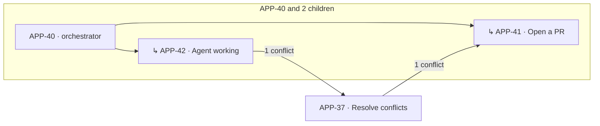

# Canvas for Paseo

**See every workspace on one map: which ones spawned which, what has to merge first, and which one needs you right now.**

A [Paseo](https://paseo.sh) plugin for people who run one worktree per issue and end up with ten or more agents in flight. Instead of clicking through chats to figure out where to look next, open **Canvas** in the sidebar.



## What you get

### 🗺️ Canvas: families and merge order

- **Families.** A workspace spawned by an agent in another workspace appears as its child, inside an outlined box with tree connectors. Every child is tagged `↳ spawned by X`, and the parent shows how many children it has.
- **Stacks.** If one workspace's branch or PR is built on another's, it is drawn as that workspace's child (`↳ stacked on X`).
- **Merge-order arrows** point from *merge first* to *merge after*:
  - 🔴 **Would conflict.** A local `git merge-tree` of the two branches conflicts.
  - 🟡 **Same files.** Both touch the same files but merge cleanly today.
  - 🔵 **Stacked** (accent color). One branch contains the other.
  
  Tap an arrow's label to see why and which files.
- **One lane per project.** Tap any card to jump to the workspace.

### ✅ Queue: what to check first

Every workspace is ranked by what it needs from *you*:

| # | Action | When |
| - | ------ | ---- |
| 1 | **Answer the agent** | Pending permission or the agent is waiting for input |
| 2 | **Agent failed** | The last turn ended with an error |
| 3 | **Merge** | PR is open, green, not a draft, and mergeable |
| 4 | **Fix CI / Address review / Resolve conflicts** | PR is blocked |
| 5 | **Review output** | Agent finished and you have not looked yet |
| 6 | **Mark ready** | Draft PR with green checks |
| 7 | **Open a PR** | Changes but no PR |
| – | *Parked* | Agent running, CI running, awaiting review, or nothing left to do |

A workspace that others are waiting on ranks higher ("unblocks 2"). A **Next:** bar at the top opens the #1 item in one tap.

Works on desktop, web, and mobile, in every Paseo theme.

## Install

Plugins must be enabled on your daemon (**Settings → Plugins → Enable plugins**). Then:

```bash
paseo plugin add juanlatorre/paseo-canvas
```

Or paste `juanlatorre/paseo-canvas` into **Settings → Plugins → Plugin source**. **Canvas** appears in the sidebar and in ⌘K.

Requires Paseo **0.9.0 or newer** and git **2.38 or newer** on the daemon host.

## How it works

Everything runs locally in the plugin's daemon process. It makes no network calls of its own.

- **Workspace, agent, and PR state** come from the Paseo SDK. Paseo already tracks git status and GitHub PRs for each workspace.
- **Parent → child** comes from the `paseo.parent-agent-id` label Paseo puts on agents created by another agent, e.g. through the Paseo MCP `create_agent` tool.
- **Conflicts** are computed with `git merge-tree --write-tree`, in memory, against both the base branch and every other workspace in the same repository. GitHub often reports mergeability as `UNKNOWN` for a while; the local check answers immediately.
- **Git access is read-only.** Canvas never checks out, fetches, commits, or modifies your worktrees or branches. Results are cached by commit id, and the view refreshes every 10 seconds.

## Develop

```bash
git clone https://github.com/juanlatorre/paseo-canvas
cd paseo-canvas
npm install
npm run typecheck
paseo plugin install "$PWD"   # first time
paseo plugin reload canvas    # after each edit
paseo plugin logs canvas      # server-side output
```

```text
index.client.tsx     sidebar item, surface, ⌘K command
index.server.ts      registers the snapshot RPC
client/              React Native UI: canvas, queue, layout
server/              snapshot builder, ranking, git helpers
shared/canvas.ts     Zod contract shared by both sides
```

## License

MIT
